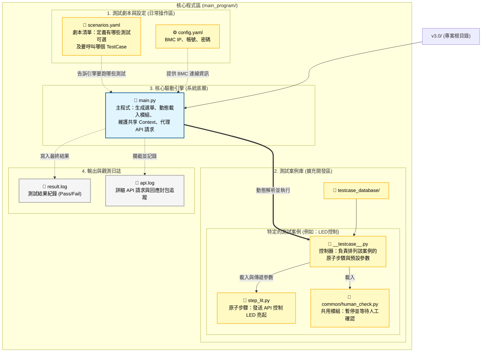
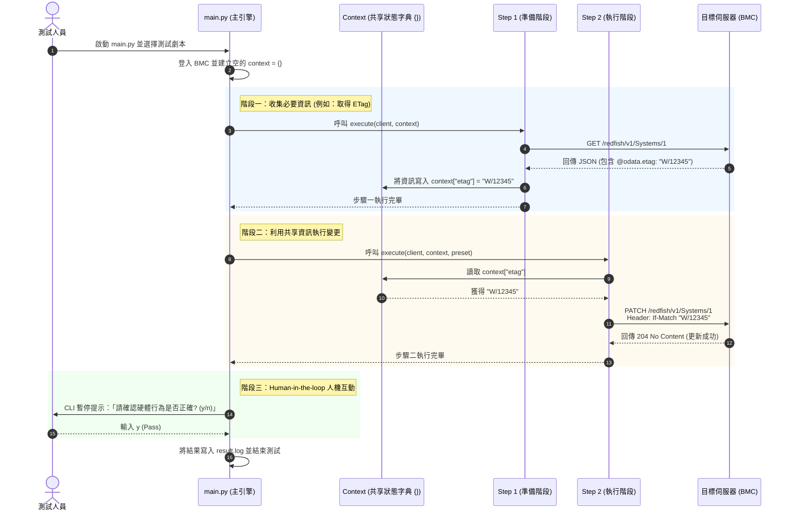

# Redfish Interactive Playbook - 系統架構與狀態流程圖

本文件展示了 Redfish 測試框架（v3.0+）的專案架構，並特別標示了**檔案之間的依賴關係**、**使用者需要自訂的區塊**，以及最新的**有狀態執行流程 (Stateful Execution Flow)**。

---

## 1. 專案架構與檔案關聯圖

此圖表展示了專案中的檔案層級，並透過顏色區分了「核心系統」與「使用者自訂區域」。

> [!TIP]
> **顏色說明：**
> - 🟡 **黃色區塊 (User Customization)**：使用者日常測試需要頻繁修改、新增參數或建立新檔案的地方。
> - 🔵 **藍色區塊 (Core Engine)**：框架底層引擎，除非要修改框架核心邏輯，否則**不需更動**。
> - ⚪ **灰色區塊 (Outputs)**：系統自動產生的日誌。

---

## 2. 有狀態執行流程 (Stateful Execution Flow)

本框架最大的特色在於**狀態共享 (Context Sharing)**。
在同一個 TestCase（測試劇本）中，多個獨立的原子步驟（Atomic Steps）可以透過一個共享的 `context` 字典來傳遞資訊。例如：第一個步驟取得 `ETag` 或 `Resource ID`，並交給第二個步驟去進行寫入動作。

## 3. 使用者自定義指南

為了讓團隊成員快速上手，以下是日常使用與擴充時需要操作的檔案：

### 🛠️ 日常測試執行
1. **`config.yaml`**: 填入當下要測試的 BMC IP 與帳號密碼。
2. **`scenarios.yaml`**: 決定今天要跑哪些測試。可以直接寫 TestCase 名稱，或是用 `- testcase_database.xxx` 陣列來混搭不同步驟。

### 🧩 新增測試功能 (擴充)
當你需要撰寫新的測試案例時，流程如下：
1. **建立原子步驟 (`step_xxx.py`)**: 撰寫單一的 Redfish API 呼叫邏輯。記得在 `execute(client, context, preset=None)` 中利用 `context` 傳遞狀態。
2. **編輯控制器 (`__testcase__.py`)**: 在 `testcase_database/你的類別/` 內，定義 `STEPS = [...]` 陣列，把剛剛寫好的原子步驟排好順序，也可以透過 `(路徑, 參數)` 傳入 Preset 值。
3. **註冊到選單**: 將這個 TestCase 加進 `scenarios.yaml`。
